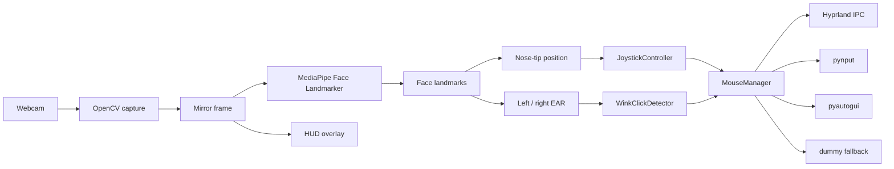

# FacePilot

[](https://github.com/vuppalasaatvikraj/facepilot/actions/workflows/tests.yml)

**Hands-free mouse control from a webcam.**

FacePilot is a local-first assistive input prototype. It tracks facial landmarks with MediaPipe, maps small head movements to relative cursor motion, and converts deliberate eye winks into mouse clicks. A live HUD shows the neutral center, dead zone, eye-opening measurements, and the most recent action.

> **Status:** local prototype, not a medical device. The Hyprland backend is the primary implementation, but live pointer injection was not re-verified while preparing this repository because the development machine runs niri rather than Hyprland. Camera, compositor, and hardware behavior remain environment-dependent. See [Limitations](#limitations) before relying on it.

## Why this exists

Conventional pointing devices assume reliable hand movement. FacePilot explores a smaller, local-only alternative: a webcam, a face-landmark model, and a small set of explicit gestures. It is intended for experimentation, accessibility research, and developers interested in low-latency human-computer interaction.

The project does **not** perform face recognition, record video, or send camera data to a server. All inference happens on the local machine.

## Implemented in the current code

| Capability | Implementation |
| --- | --- |
| Cursor control | Nose-tip landmark (`1`) drives a relative, joystick-style velocity controller with a circular dead zone, EMA smoothing, a speed cap, and fractional-pixel accumulation. |
| Left click | A deliberate left-eye wink, confirmed across consecutive frames, emits one left click after a short double-click window. |
| Double click | Two left-eye winks inside the window emit a native double click. |
| Right click | A deliberate right-eye wink emits one right click. |
| Blink rejection | Bilateral eye closure is treated as a natural blink and does not click. |
| Live HUD | Mirrored preview, eye contours, dead-zone reticle, direction arrow, left/right EAR gauges, action banner, and FPS/settings display. |
| Runtime tuning | Keyboard shortcuts for recalibration, pause, speed, and dead-zone size. |
| Input backends | Hyprland IPC first; `pynput` and `pyautogui` fallbacks are present in the code. |

### Not implemented

These are **planned or experimental**, not current features:

- Smile-to-keyboard and an on-screen keyboard.
- A fail-closed safety gate that blocks every side effect from one place.
- Persistent calibration profiles.
- A `uinput` backend for non-Hyprland Wayland compositors.
- Start-paused behavior and a separate control client.
- Automated camera, compositor, or hardware-injection tests.

## Architecture



The application is a single-process program with one main loop. Each camera frame is mirrored, passed to MediaPipe, reduced to two signals (nose-tip position and per-eye EAR), and then fed to two independent controllers. The controllers never read the camera directly, which keeps the cursor and wink logic testable without hardware.

| Component | Responsibility |
| --- | --- |
| `FaceTracker` | Initializes MediaPipe Tasks or the legacy Solutions API and returns face landmarks for a BGR frame. |
| `calculate_ear` | Converts three vertical eye distances and one horizontal distance into an Eye Aspect Ratio. |
| `JoystickController` | Applies calibration, dead zone, proportional velocity, EMA smoothing, speed cap, and sub-pixel accumulation. |
| `WinkClickDetector` | Runs the per-eye wink state machine, rejects bilateral blinks, debounces actions, and detects double winks. |
| `HUDOverlay` | Draws the preview, eye contours, dead-zone reticle, EAR gauges, banners, and controls. |
| `MouseManager` | Selects and coordinates the Hyprland, `pynput`, `pyautogui`, or dummy backend. |
| `FacePilotApp` | Owns the capture loop, keyboard shortcuts, pause state, and cleanup. |

More detail, including the cursor equations and state transitions, is in [`docs/ARCHITECTURE.md`](docs/ARCHITECTURE.md).

## Technology stack

| Layer | Choice | Notes |
| --- | --- | --- |
| Language | Python 3.10+ | Unit tests were run on Python 3.14.8; the live app was not re-run during repository preparation. Check MediaPipe wheel availability for your platform and Python version. |
| Face tracking | [MediaPipe Face Landmarker](https://ai.google.dev/edge/mediapipe/solutions/vision/face_landmarker) | Tasks API first; legacy Face Mesh Solutions API fallback. |
| Camera and HUD | [OpenCV](https://opencv.org/) (`opencv-python`) | Capture, mirroring, drawing, and windowing. |
| Numerics | [NumPy](https://numpy.org/) | Landmark geometry and EAR. |
| Input injection | Hyprland IPC, [pynput](https://pynput.readthedocs.io/), [PyAutoGUI](https://pyautogui.readthedocs.io/) | Hyprland is the primary path; the other backends are fallbacks. |
| Tests | `unittest` (standard library) | No camera or display required. |
| CI | GitHub Actions | Runs the pure-Python tests with headless OpenCV on Python 3.12. |

No cloud inference, database, message queue, or web framework is involved.

## Project structure

```text
facepilot/
├── facepilot.py              # Application: tracking, cursor, winks, HUD, backends
├── requirements.txt          # Runtime dependencies
├── README.md
├── SECURITY.md               # Privacy and vulnerability-reporting policy
├── CONTRIBUTING.md
├── LICENSE                   # MIT
├── .gitignore
├── docs/
│   └── ARCHITECTURE.md       # Detailed design and known failure modes
├── tests/
│   └── test_facepilot.py     # Hardware-independent unit tests
└── .github/
    └── workflows/
        └── tests.yml         # Pure-logic CI
```

`face_landmarker.task` is **not** committed. The app downloads it on first run if it is missing.

## Installation

### Prerequisites

- Python 3.10 or newer.
- A webcam.
- Linux with a working graphical session for the live pointer path.
- For the native backend: Hyprland with `HYPRLAND_INSTANCE_SIGNATURE` set (Hyprland sets this itself).
- For the fallback backends: a working `pynput`/`pyautogui` environment. X11 is the most likely fallback environment; Wayland global injection is compositor-dependent.

On Linux, make sure your user can read the camera device:

```bash
ls -l /dev/video0
```

If needed, add your user to the `video` group and log out/in:

```bash
sudo usermod -aG video "$USER"
```

### Setup

```bash
git clone https://github.com/vuppalasaatvikraj/facepilot.git
cd facepilot

python3 -m venv .venv
source .venv/bin/activate

python -m pip install --upgrade pip
pip install -r requirements.txt
```

The repository does not ship a virtual environment. Create your own; `.venv/` is ignored.

### Model file

The first run downloads a roughly 3.7 MB MediaPipe model from Google's CDN into `face_landmarker.task` in the working directory. The file is gitignored. To run offline, download it beforehand:

```bash
python - <<'PY'
import urllib.request
url = "https://storage.googleapis.com/mediapipe-models/face_landmarker/face_landmarker/float16/latest/face_landmarker.task"
urllib.request.urlretrieve(url, "face_landmarker.task")
PY
```

The copy used during development had this SHA-256:

```text
64184e229b263107bc2b804c6625db1341ff2bb731874b0bcc2fe6544e0bc9ff
```

The application does **not** currently verify that hash. Use `--model /path/to/face_landmarker.task` to point at a different copy.

## Usage

```bash
source .venv/bin/activate
python facepilot.py
```

The application opens the camera, starts tracking, and immediately begins controlling the pointer. Sit comfortably, look at the screen, and press `c` to set the neutral head position. If the camera or face model cannot initialize, the process exits with an error. If no mouse backend is available, it falls back to a dummy backend.

### Command-line options

| Flag | Default | Description |
| --- | --- | --- |
| `--camera` | `0` | Webcam device index. |
| `--width` | `640` | Requested capture width. |
| `--height` | `480` | Requested capture height. |
| `--deadzone` | `25.0` | Circular dead-zone radius in pixels. |
| `--speed` | `0.35` | Joystick velocity multiplier. |
| `--max-speed` | `40.0` | Maximum cursor movement per update, in pixels. |
| `--smooth` | `0.65` | EMA position smoothing alpha; `1.0` is raw. |
| `--ear-thresh` | `0.20` | EAR below which an eye is considered closed. |
| `--ear-open` | `0.23` | EAR above which an eye is considered open. |
| `--double-click-window` | `0.45` | Seconds allowed between two left winks. |
| `--cooldown` | `0.25` | Debounce interval between actions. |
| `--wink-frames` | `2` | Consecutive frames required to confirm a wink. |
| `--backend` | `auto` | `auto`, `hyprland`, `pynput`, or `pyautogui`. |
| `--model` | `face_landmarker.task` | Path to the MediaPipe model. |

Examples:

```bash
# Faster movement on a large display
python facepilot.py --speed 0.50 --deadzone 20

# More forgiving wink thresholds for glasses or a small eye opening
python facepilot.py --ear-thresh 0.22 --ear-open 0.25

# Force a backend instead of automatic selection
python facepilot.py --backend pynput
```

### Runtime shortcuts

| Key | Action |
| --- | --- |
| `c` | Recalibrate the neutral head position to the current posture. |
| `p` | Pause or resume pointer control and click actions. |
| `q` / `Esc` | Quit and release the camera. |
| `+` / `-` | Increase or decrease the speed factor by `0.05`. |
| `]` / `[` | Increase or decrease the dead-zone radius by `2 px`. |

The HUD window must be focused for OpenCV to receive these keys. `p` is the intended emergency stop; see [Limitations](#limitations).

## Demo

No verified screenshot or recording is checked in yet. The HUD is rendered live by OpenCV, so the most useful next documentation asset is a real capture from a working backend. A useful clip would show the neutral dead zone, one single wink, one double wink, a right wink, and the pause banner.

## Configuration and privacy

- There is no `.env` file, API key, account, or cloud service.
- `HYPRLAND_INSTANCE_SIGNATURE` is read from the environment when present; Hyprland sets it. It is not a credential and is never written to disk by this project.
- Camera frames are processed in memory and are not saved. No telemetry is emitted.
- The only outbound request is the one-time model download when the model file is absent.
- All tuning is currently command-line based; there is no persistent config file.

See [`SECURITY.md`](SECURITY.md) for the security model and reporting process.

## Testing

| Check | Result |
| --- | --- |
| Hardware-independent unit suite | 15 tests pass on Python 3.14.8 |
| CLI parsing (`--help`) | Pass |
| Live camera + MediaPipe loop | Not run during repository preparation |
| Hyprland input injection | Not run; the development session is niri |
| GitHub Actions workflow | Passing on `main` (Python 3.12, headless OpenCV) |

Run the hardware-independent suite:

```bash
python -m unittest discover -s tests -v
```

The tests cover:

- EAR math for open and closed synthetic eyes.
- Dead-zone behavior, direction, speed cap, and recalibration.
- Automatic first-frame calibration.
- Natural-blink rejection.
- Left/right wink clicks, double clicks, pause suppression, cooldown, and tracking-loss cancellation.
- CLI argument defaults and overrides.

They do **not** open a camera, run MediaPipe inference, initialize a compositor backend, or inject real input. Those paths require a manual hardware test on the target desktop. The GitHub Actions workflow runs the same pure-logic suite on Python 3.12 with headless OpenCV; the current `main` run passes.

## Limitations

- **Prototype status.** There is no formal user study, clinical evaluation, or accessibility certification. FacePilot is not a medical device.
- **Hardware coverage.** Live pointer injection was not re-verified during repository preparation; the development machine runs niri, not Hyprland. macOS, Windows, X11, and non-Hyprland Wayland sessions are unverified even though fallback code exists.
- **Compositor coupling.** The Hyprland backend calls `hl.dsp.cursor.move` and `hl.dsp.send_shortcut` over a UNIX socket. Hyprland configuration and IPC syntax can change between versions.
- **Click dispatch.** When Hyprland is active and `pynput` is importable, the click path intentionally dispatches through both for XWayland compatibility. Verify click counts on your setup; duplicate clicks are possible.
- **Fallback safety.** The `pyautogui` fallback sets `FAILSAFE = False` for low latency. Use `p` to pause; do not rely on the corner failsafe.
- **Model integrity.** The model is downloaded over HTTPS but its SHA-256 is not enforced by the application.
- **Gesture robustness.** EAR thresholds are sensitive to lighting, eyewear, camera angle, and face shape. Tune `--ear-thresh` and `--ear-open`; the defaults are starting points, not calibrated values.
- **No persistence.** Calibration and runtime tuning reset when the process exits.
- **HUD size.** The overlay is laid out for the default 640x480 capture; very small frames may clip the gauges and banner.
- **Single file.** The prototype is intentionally monolithic. The v0.2 design in the roadmap separates vision, gesture logic, safety, and input backends.
- **Starts active.** Launching the app begins pointer control immediately; there is no start-paused mode yet.
- **No demo asset.** No verified screenshot or recording is checked in. The HUD is best evaluated by running the app on your own camera.

## Roadmap

Planned work, clearly separate from the current prototype:

- A fail-closed safety gate that every pointer, click, and keyboard action passes through.
- A deterministic, camera-independent gesture engine with replayable signal fixtures.
- Start-paused behavior, persistent calibration profiles, and a local control client.
- A `uinput`/evdev backend for Wayland compositors other than Hyprland.
- Smile-to-keyboard and an on-screen keyboard integration.
- A recorded demo and a hardware test matrix covering at least one X11 and one Wayland setup.
- Packaging and pinned dependency versions after the input path stabilizes.

## Contributing

Contributions are welcome. Read [`CONTRIBUTING.md`](CONTRIBUTING.md) for the development setup, test expectations, and the rule against committing secrets or camera data.

## License

Released under the [MIT License](LICENSE).

## Acknowledgements and prior art

- [MediaPipe](https://github.com/google-ai-edge/mediapipe) provides the Face Landmarker model and runtime.
- [OpenCV](https://opencv.org/), [NumPy](https://numpy.org/), [pynput](https://github.com/moses-palmer/pynput), and [PyAutoGUI](https://github.com/asweigart/pyautogui) provide capture, numerics, and input plumbing.
- The Eye Aspect Ratio approach follows Soukupová and Čech, *Real-Time Eye Blink Detection Using Facial Landmarks* (2016).
- Prior art includes [Tracky Mouse](https://github.com/1j01/tracky-mouse) (head tracking and wink clicking) and [Google Project Gameface](https://github.com/google/project-gameface) (MediaPipe-based hands-free input). FacePilot does not claim novelty over these projects.
