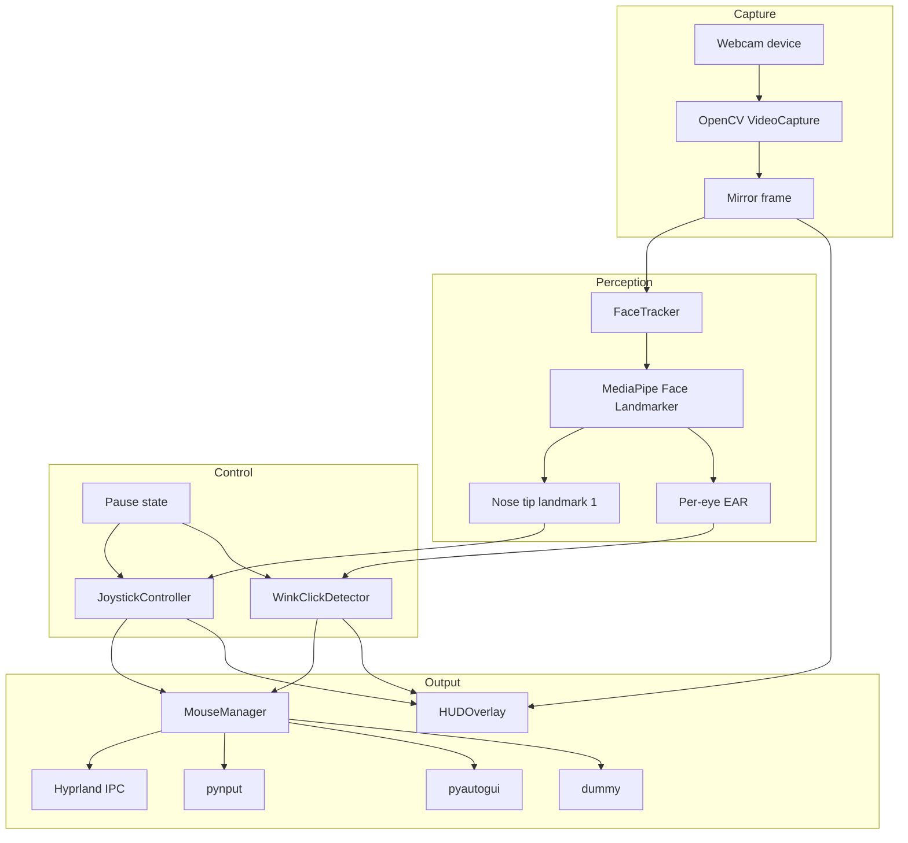
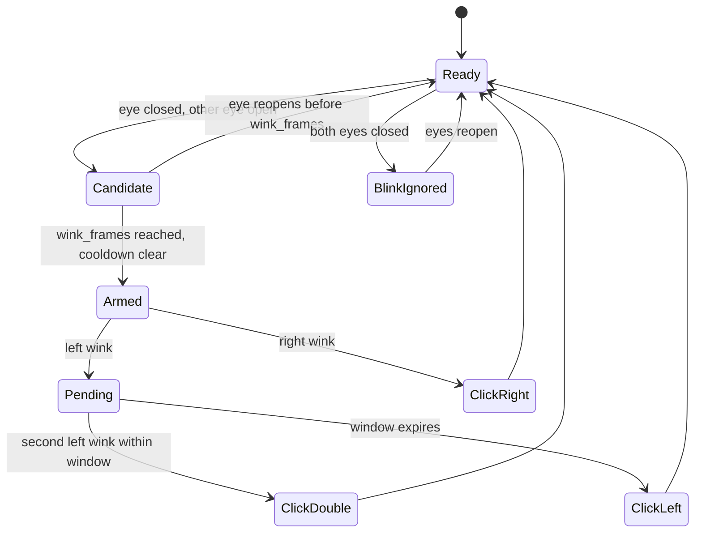

# Architecture

This document describes the **current prototype** in `facepilot.py`. It is not a description of the planned v0.2 engine. Where the two differ, the difference is called out explicitly.

## Design goals and constraints

FacePilot is a local-first input prototype. The design optimizes for a short path from camera frame to pointer action:

- One Python process and one main loop. No services, queues, databases, or cloud calls.
- Relative cursor motion rather than absolute screen mapping, so the app does not need to know the pointer position on every frame.
- Explicit, debounced gestures rather than continuous click signals.
- A mirrored preview so the user's movement direction matches the screen.
- Hardware-independent tests for the math and gesture logic.
- No face recognition, video recording, telemetry, or camera-frame persistence.

The prototype also has deliberate constraints:

- The application is a single-file script. This keeps the original implementation easy to copy and run, but it couples vision, UI, and input backends.
- There is no central safety gate. Each controller calls the mouse manager directly.
- There is no persistent configuration or calibration profile.

## Runtime topology



The application's own code runs in one main loop inside `FacePilotApp.run()`; the project does not create worker threads or a producer/consumer queue. The HUD and the controllers consume the same frame. Third-party libraries may use internal threads, which is outside this diagram.

## Frame lifecycle

1. `FacePilotApp.setup_camera()` opens `cv2.VideoCapture(camera)`, requests the configured width/height, and sets the capture FPS to 30. It raises `RuntimeError` if the device cannot be opened.
2. `FacePilotApp.run()` reads a BGR frame. A failed read is retried after a 5 ms sleep; it does not crash the loop.
3. The frame is horizontally flipped (`cv2.flip(frame, 1)`), producing the mirror preview used everywhere downstream.
4. FPS is smoothed with `fps = 0.9 * fps + 0.1 * (1 / dt)`.
5. `FaceTracker.process()` converts the frame to RGB and runs either the MediaPipe Tasks `FaceLandmarker` or the legacy `FaceMesh` Solutions API. It returns one landmark list or `None`.
6. If landmarks exist:
   - The nose tip (`landmark 1`) is converted from normalized coordinates to pixels.
   - `JoystickController.update()` converts the nose position into an integer cursor delta.
   - The two eye landmark groups are assigned to the left and right side of the mirrored image by comparing their horizontal centers.
   - `calculate_ear()` produces one EAR value per eye.
   - `WinkClickDetector.update()` may emit a click through `MouseManager`.
7. `HUDOverlay.draw()` renders the preview, eye contours, cursor reticle, gauges, and banners.
8. `cv2.waitKey(1)` handles `c`, `p`, `q`/Esc, `+`/`-`, and `[`/`]`.
9. `finally` calls `cleanup()`: release the camera, destroy OpenCV windows, and close the MediaPipe detector.

## Coordinate systems and mirroring

MediaPipe returns normalized landmark coordinates in the range `[0, 1]`. The prototype multiplies by the frame width/height to work in pixels:

```text
raw_nose_x = landmark.x * frame_width
raw_nose_y = landmark.y * frame_height
```

The frame is mirrored **before** landmark detection. As a result, the user's left eye appears on the left side of the preview and the user's right eye appears on the right side, matching normal mirror intuition. The code does not assume a fixed landmark group is always on one side. It compares the centers of the two canonical eye groups and assigns the screen-left group to `left_ear`, the screen-right group to `right_ear`.

The wink labels therefore describe the **eye on that side of the mirrored preview**, which is also the user's anatomical side. If a camera or future pipeline changes the mirroring, this mapping must be re-checked.

## Cursor controller

`JoystickController` implements a relative velocity joystick with a circular dead zone. The important variables are:

| Variable | Meaning |
| --- | --- |
| `center_x`, `center_y` | Calibrated neutral nose position. |
| `smooth_nose_x`, `smooth_nose_y` | EMA-smoothed nose position. |
| `v_x`, `v_y` | EMA-smoothed velocity. |
| `accum_x`, `accum_y` | Fractional pixels carried between frames. |
| `deadzone` | Radius in pixels where the cursor does not move. |
| `speed_factor` | Gain applied to displacement beyond the dead zone. |
| `max_speed` | Per-update movement cap in pixels. |

For a raw nose position `(x, y)`:

```text
smooth = alpha * raw + (1 - alpha) * smooth
dx = smooth_x - center_x
dy = smooth_y - center_y
distance = hypot(dx, dy)
```

If `distance <= deadzone`, velocity and accumulators are reset to zero and the method returns `(0, 0, distance, False)`.

Otherwise:

```text
excess = distance - deadzone
unit = (dx / distance, dy / distance)
target_speed = min(max_speed, speed_factor * excess)
target_v = unit * target_speed
v = vel_alpha * target_v + (1 - vel_alpha) * v
accum += v
move = int(accum)
accum -= move
```

The integer conversion truncates toward zero. The accumulator preserves the fractional remainder, so slow movements eventually produce a one-pixel step instead of being lost.

`max_speed` is **pixels per update**, not pixels per second. At a higher frame rate, the same value produces faster physical motion. This is a property of the prototype, not a calibrated latency guarantee.

Calibration is automatic on the first detected frame. Pressing `c` calls `calibrate()` with the current nose position and resets the smoothing, velocity, and accumulators. Calibration is not persisted.

## Wink and click detection

`WinkClickDetector` consumes the left and right EAR values, the pause flag, and an injected timestamp. It is deliberately independent of OpenCV and MediaPipe, which makes the state behavior testable with synthetic numbers.

### Thresholds

| Parameter | Default | Role |
| --- | --- | --- |
| `--ear-thresh` | `0.20` | Below this, the eye is considered closed. |
| `--ear-open` | `0.23` | At or above this, the eye is considered open. The gap provides hysteresis. |
| `--wink-frames` | `2` | Consecutive closed frames required before an action. |
| `--cooldown` | `0.25` s | Minimum time between actions. |
| `--double-click-window` | `0.45` s | Maximum gap between two left winks for a double click. |

### Behavior

- **Bilateral closure:** if both eyes are below `ear_thresh`, the detector resets both counters, displays `Blink (Ignored)`, and returns. A natural blink never clicks.
- **Left wink:** the left eye is closed and the right eye is at or above `ear_open`. After `wink_frames` consecutive frames and the cooldown, the first wink arms a pending left click. A second left wink inside the double-click window emits `click(left, count=2)`. If the window expires, the pending click emits `click(left, count=1)`.
- **Right wink:** the right eye is closed and the left eye is at or above `ear_open`. After confirmation, any pending left click is resolved first, then a right click is emitted.
- **Pause:** the detector still updates its state, but every `mouse.click()` call is guarded by `not is_paused`. The HUD still shows the detected action.
- **Release:** reopening an eye clears its `held` flag and counter so a new wink can be recognized.
- **Tracking loss:** when no landmarks are returned, the app calls `reset_tracking()`, clearing per-eye state and cancelling any armed left click. This prevents a stale wink from firing after the face leaves and re-enters the frame.

The pending-left-click model means a single left click is delayed by up to the double-click window. This is the price of supporting double clicks with one gesture.

### State sketch



The implementation is not a formal state-machine class; the diagram summarizes the branches in `WinkClickDetector.update()`.

## Input backends

`MouseManager` selects a backend at startup:

1. If `pynput` is importable, construct a `pynput.mouse.Controller` as an auxiliary path.
2. If the requested backend is `auto` or `hyprland` and `HYPRLAND_INSTANCE_SIGNATURE` is set, try `HyprlandMouse`. If it initializes, the active backend is `hyprland`.
3. Otherwise, use `pynput` if available, then `pyautogui`, then `dummy`.
4. `dummy` accepts moves and clicks but does nothing.

### Hyprland backend

`HyprlandMouse` connects to:

```text
/run/user/<uid>/hypr/<HYPRLAND_INSTANCE_SIGNATURE>/.socket.sock
```

It queries monitors with `j/monitors` to derive desktop bounds, reads the cursor position with `cursorpos`, and sends commands:

```text
dispatch hl.dsp.cursor.move({ x = <x>, y = <y> })
dispatch hl.dsp.send_shortcut({ mods = "", key = "mouse:272" })   # left
dispatch hl.dsp.send_shortcut({ mods = "", key = "mouse:273" })   # right
```

These commands are Hyprland-version-dependent. Initialization failures fall back to another backend, but runtime socket errors are not caught by every call, and the prototype does not implement protocol-version negotiation.

### Fallback behavior

- `pynput` and `pyautogui` are optional imports. A failed import sets an availability flag rather than crashing the module.
- `pyautogui.PAUSE` is set to `0.0` and `FAILSAFE` is disabled for low latency. The `p` shortcut is the intended stop mechanism.
- When the Hyprland backend is active and `pynput` is importable, `MouseManager.click()` dispatches through both paths so XWayland surfaces can receive the click. On some setups this may produce duplicate clicks; it is a known compatibility trade-off, not a verified universal behavior.

## HUD

`HUDOverlay` is a stateless drawing helper. It renders:

- Eye landmark polylines.
- A dead-zone circle and crosshair at the calibrated center.
- The current nose point and a direction arrow.
- Left and right EAR gauges with threshold markers.
- A top status bar with FPS, speed, dead-zone size, and tilt.
- An action banner for clicks, blinks, pause/resume, recalibration, speed, and dead-zone changes.
- A bottom shortcut bar.

The HUD uses OpenCV's HighGUI window (`cv2.imshow`). It requires a display server and a working OpenCV GUI backend. The layout is designed for the default 640x480 capture; very small frames may clip the gauges or banner. The unit tests do not exercise the HUD.

## Error handling and cleanup

- Camera open failure: `RuntimeError` from `setup_camera()`.
- MediaPipe initialization: Tasks API first, then the legacy Solutions API; if both fail, `RuntimeError`.
- Model download: `urllib.request.urlretrieve` on first use; failure propagates as an exception during tracker setup.
- Fallback moves/clicks: `pynput` and `pyautogui` exceptions are swallowed to keep the camera loop alive. This improves resilience but can hide a broken backend; the startup printout shows the selected backend. Hyprland runtime errors are not uniformly caught.
- Shutdown: camera release, window destruction, and detector close run in `finally`.

There is no general watchdog for a frozen camera, a stale frame, multiple faces, or low confidence. No-face frames reset the gesture state, but the prototype otherwise keeps the last cursor state and continues. That is one of the reasons the planned v0.2 safety gate matters.

## Security and privacy properties

- Frames are processed in memory and are not written to disk.
- There is no telemetry, analytics, account, or cloud inference.
- The only network request in the code is the model download from `storage.googleapis.com`.
- The model hash is not pinned or verified at runtime.
- The app injects global pointer and click events. That is a powerful capability; run it only on a desktop you control and keep the pause shortcut available.
- No secrets are required. There is no `.env` file and no credential handling.

See [`../SECURITY.md`](../SECURITY.md) for reporting and operational guidance.

## Test strategy

`tests/test_facepilot.py` uses synthetic landmarks and a fake mouse. It tests:

- EAR values for open/closed eyes and the degenerate zero-width case.
- Dead-zone behavior, direction, speed cap, recalibration, and automatic first-frame calibration.
- Natural-blink rejection, left/right click emission, double click, pause suppression, cooldown, and tracking-loss cancellation.
- CLI defaults and overrides.

The tests do not cover:

- MediaPipe inference or model loading.
- OpenCV capture or GUI behavior.
- Hyprland socket commands, `pynput`, or `pyautogui`.
- Real click timing, camera latency, or false-activation rates.
- Multi-face, low-light, eyewear, or occlusion behavior.

Those require a manual hardware test. No performance numbers are claimed because none were measured during repository preparation.

## Planned v0.2 direction

The next design separates concerns that are currently coupled:

- Vision adapter that emits normalized face signals.
- Deterministic gesture engine with an injected clock and replayable fixtures.
- A single fail-closed safety gate in front of every side effect.
- Input backends behind a common interface, including a `uinput` path.
- Start-paused state, persistent calibration, and a local control client.
- On-screen keyboard and smile gesture.

That work is planned, not implemented in this repository.
